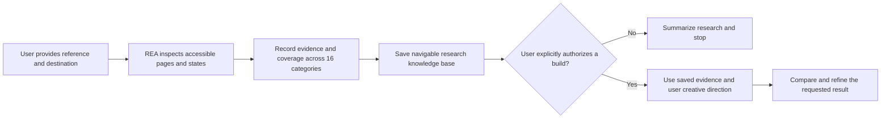

<div align="center">

# REA Websites

**Research website references with Reverse Engineer Anything. Keep the evidence ready for a later, user-directed build.**

[](LICENSE)
[](skills/rea-websites/SKILL.md)
[](https://github.com/morluto/rea)

[What it does](#what-it-does) · [Prerequisites](#prerequisites) · [Quick start](#quick-start) · [Capabilities](#capabilities) · [Workflow](#workflow) · [Examples](#example-prompts) · [FAQ](#faq)

</div>

> [!IMPORTANT]
> Install the upstream `reverse-engineer-anything` skill on your computer and connect REA MCP before using REA Websites. This companion skill does not install REA. [Set up REA first](https://github.com/morluto/rea#quick-start).

## What it does

REA Websites is a Codex skill for deep, evidence-led research of complete reference websites and user-selected features. It uses [Reverse Engineer Anything (REA)](https://github.com/morluto/rea) to inspect accessible pages, components, and states, then records findings for an explicitly authorized recreation or comparison/refinement task.

The skill covers all 16 research categories: overall visual identity; color system; structure and layout; header and navigation; buttons and interactive elements; cursor interactions; scrolling and animation; photography; typography; text animation; transitions and loading; hero; components and content sections; responsive design; performance and technical behavior; and microinteractions.

It keeps evidence levels clear: verified, inferred, estimated, or unknown. Exact colors are reported with CSS/computed-value provenance when inspected; screenshot samples are labeled estimates. Research completion does not start implementation. During a later authorized build, the user's creative direction guides adaptation and comparison.

> **Scope:** this project provides skill instructions and references. It does not include the REA MCP server, install REA, or replace REA. REA is maintained upstream by [morluto/rea](https://github.com/morluto/rea); this is an independent companion project.

## Prerequisites

**Both prerequisites are required for REA-backed investigation:**

1. The `reverse-engineer-anything` skill is installed on your computer.
2. REA MCP is connected to the agent you use with this skill.

Installing this repository's skill alone does **not** install either prerequisite or register REA tools. Set up REA separately using its [official repository instructions](https://github.com/morluto/rea). Upstream currently documents `npx rea-agents setup`, requiring Node.js and npm; review proposed changes and restart your agent as directed there.

Browser research also needs a Chrome-family browser with configured CDP or a supported REA scenario session. See the upstream [browser observation guide](https://github.com/morluto/rea/blob/main/docs/browser-observation.md). Available tools and schemas can differ by REA version; the skill discovers and follows what is actually installed. If prerequisites are missing, it explains the limitation and does only work supported by the available evidence.

## Quick start

### Install the skill

In Codex, ask the skill installer:

```text
$skill-installer install the rea-websites skill from https://github.com/gjaekz/rea-websites/tree/main/skills/rea-websites
```

Or copy `skills/rea-websites` into your Codex skills directory, preserving its folders and files. Restart or refresh Codex as needed for skill discovery. Then invoke it with a reference URL and a destination for the research files:

```text
Use $rea-websites to research https://example.com and save the knowledge base in ./research/example.
```

Install and configure REA independently before requesting REA-backed research; see [Prerequisites](#prerequisites).

## Capabilities

| Research area | What the skill records |
| --- | --- |
| Visual identity and layout | Style, hierarchy, spacing, composition, page structure, and section patterns |
| Color and typography | Source-backed colors and tokens, pairings, type hierarchy, and text treatments |
| Navigation and interaction | Header states, controls, cursor behavior, focus states, and microinteractions |
| Motion and transitions | Scroll behavior, triggers, animation states, loading, and page transitions |
| Media and content | Image placement, crops, galleries, hero, components, and content sections |
| Responsive behavior | Observed viewport changes, navigation, image recrops, overflow, and touch states |
| Technical behavior | Observable performance, loading stability, accessibility, and investigation limits |
| Evidence and handoff | Coverage ledger, reusable knowledge base, implementation notes, and unknowns |

Full-site research uses the detailed 16-category checklist in [`research-checklist.md`](skills/rea-websites/references/research-checklist.md). For focused feature research, see the [main and targeted workflows](skills/rea-websites/references/REVERSE_ENGINEERING_WORKFLOW.md).

## Workflow



Research is the default for analysis requests. Finishing research alone never authorizes implementation or external actions. On a later authorized build, the skill reuses the saved findings and only revisits the reference to resolve a concrete gap.

## Example prompts

```text
Use $rea-websites to investigate the navigation menu on https://example.com, including how it opens and closes. Save the focused findings in ./research/example.
```


```text
Use $rea-websites to research https://example.com and save the knowledge base in ./research/example.
```

```text
Using the saved research in ./research/example, build a distinct landing page for my product with the brand direction described below: ...
```

```text
Compare my implementation at ./site with the reference research in ./research/example. Refine the layout and motion to match the documented states while following my creative direction: ...
```

The latter two requests explicitly authorize implementation in the stated scope. Adapt prompts to your project and constraints.

## Example output

Full-site research contains a navigable index, a coverage status ledger, a color palette with provenance, and a recreation guide. Targeted research adds a focused analysis and implementation guide to the existing research root; it does not require unrelated site-wide documents. See the [knowledge-base guide](skills/rea-websites/references/knowledge-base.md). The optional topic notes and screenshot folder below are illustrative examples; they are created only when findings and available evidence warrant them.

```text
research/example/
├── RESEARCH_INDEX.md
├── RESEARCH_STATUS.md
├── COLOR_PALETTE.md
├── RECREATION_GUIDE.md
├── typography.md             # optional, when findings warrant it
├── layout.md                 # optional, when findings warrant it
├── animations.md             # optional, when findings warrant it
├── responsive-design.md      # optional, when findings warrant it
└── screenshots/              # optional, only when captures were produced
```

Every material finding distinguishes **Verified**, **Inferred**, **Estimated**, and **Unknown** evidence. Color values identify their source: inspected CSS/computed values can be exact and verified; pixel samples from screenshots remain estimates. Coverage gaps and tool limits are recorded rather than hidden.

## FAQ

<details>
<summary>Does installing this skill set up REA?</summary>

No. Install the `reverse-engineer-anything` skill and connect REA MCP separately. This repository contains neither the server nor an installer for it.
</details>

<details>
<summary>Can it research a site without REA?</summary>

It must not imply REA was used when REA is unavailable. The skill reports the limitation and may continue only with supported work, clearly marking the uninvestigated areas.
</details>

<details>
<summary>Does research automatically create a website?</summary>

No. Implementation begins only after an explicit build request. Saved evidence is reused, and your creative direction controls adaptation.
</details>

<details>
<summary>Are screenshot color samples exact?</summary>

No. Screenshot-derived colors are estimates. Exact, verified values require inspected CSS, computed styles, or design tokens with their provenance recorded.
</details>

<details>
<summary>Where do the output formats come from?</summary>

The skill's [knowledge-base guide](skills/rea-websites/references/knowledge-base.md) defines the canonical files, evidence records, provenance labels, and research-to-build handoff.
</details>

## Contributing

Contributions and issue reports are welcome through the [GitHub issues](https://github.com/gjaekz/rea-websites/issues) and [pull requests](https://github.com/gjaekz/rea-websites/pulls) for this repository.

## Attribution and license

REA Websites is an independent companion skill and is not affiliated with or endorsed by the REA project. REA itself is developed by [morluto](https://github.com/morluto/rea); consult its repository for its own license and setup requirements.

This repository is licensed under the MIT License. See [`LICENSE`](LICENSE).
